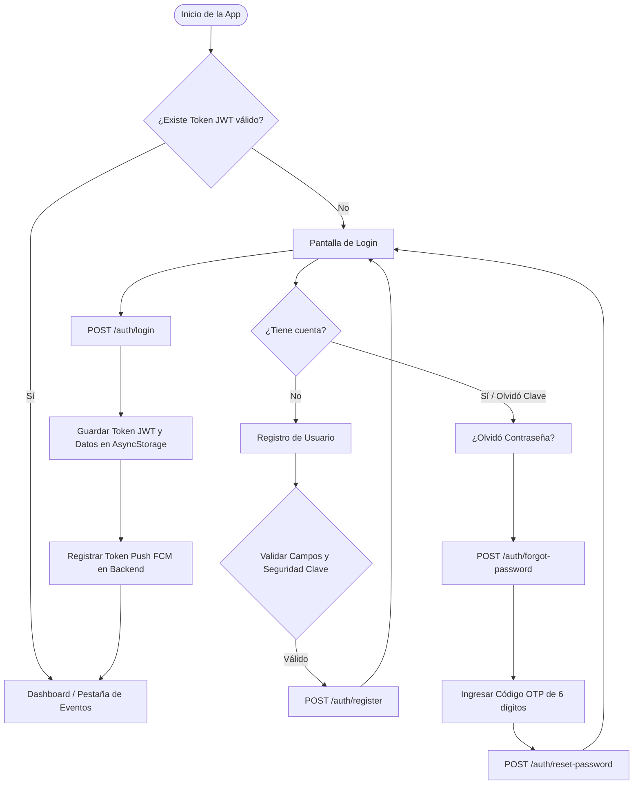
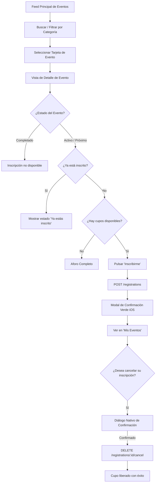
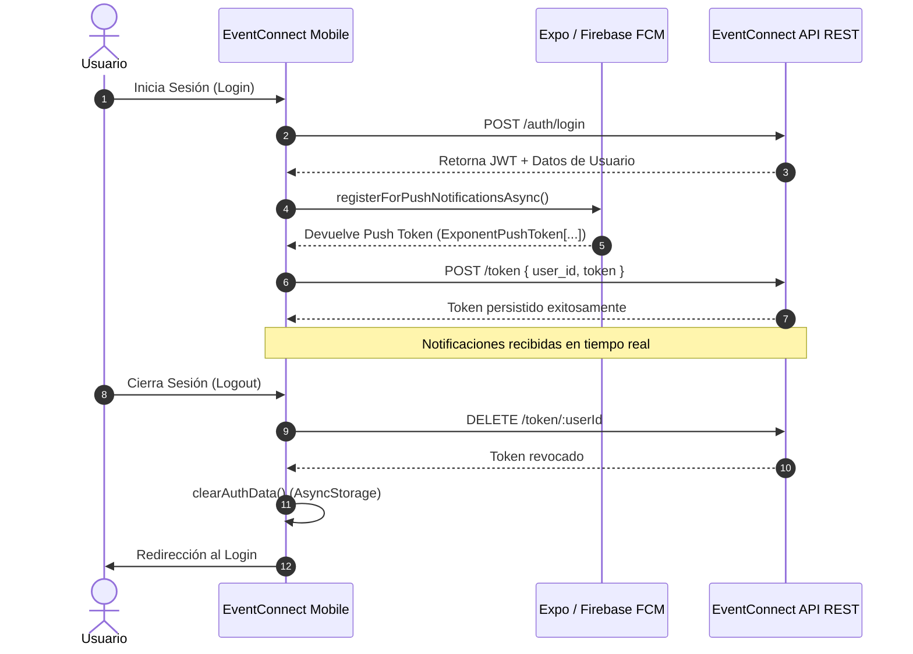

# 📖 EventConnect Mobile - Documentación Integral del Sistema

> **Guía Técnica y Funcional del Programa para Portafolio Profesional**  
> Desarrollado con **React Native**, **Expo SDK 54**, **TypeScript** y **Expo Router**.

---

## 📑 Tabla de Contenidos

- [📖 EventConnect Mobile - Documentación Integral del Sistema](#-eventconnect-mobile---documentación-integral-del-sistema)
  - [📑 Tabla de Contenidos](#-tabla-de-contenidos)
  - [1. ¿Qué es EventConnect Mobile?](#1-qué-es-eventconnect-mobile)
  - [2. Problemática que Resuelve](#2-problemática-que-resuelve)
  - [3. ¿Qué Hace el Programa? (Funcionalidades Principales)](#3-qué-hace-el-programa-funcionalidades-principales)
    - [🔐 1. Gestión Integral de Sesión y Seguridad](#-1-gestión-integral-de-sesión-y-seguridad)
    - [📅 2. Exploración Inteligente de Eventos](#-2-exploración-inteligente-de-eventos)
    - [✍️ 3. Inscripción y Gestión de Eventos ("Mis Eventos")](#️-3-inscripción-y-gestión-de-eventos-mis-eventos)
    - [🔔 4. Notificaciones Push en Tiempo Real](#-4-notificaciones-push-en-tiempo-real)
    - [🎨 5. Experiencia de Usuario Adaptativa (UX/UI)](#-5-experiencia-de-usuario-adaptativa-uxui)
  - [4. Flujos de Usuario y Diagramas](#4-flujos-de-usuario-y-diagramas)
    - [4.1 Flujo de Autenticación y Recuperación](#41-flujo-de-autenticación-y-recuperación)
    - [4.2 Flujo de Exploración y Registro en Eventos](#42-flujo-de-exploración-y-registro-en-eventos)
    - [4.3 Flujo del Ciclo de Vida del Token de Notificaciones Push](#43-flujo-del-ciclo-de-vida-del-token-de-notificaciones-push)
  - [5. Recorrido de Pantallas y Módulos](#5-recorrido-de-pantallas-y-módulos)
  - [6. Arquitectura de Software y Patrones de Diseño](#6-arquitectura-de-software-y-patrones-de-diseño)
    - [1. File-Based Routing (Expo Router)](#1-file-based-routing-expo-router)
    - [2. Capa de Servicios Centralizada (`src/services/`)](#2-capa-de-servicios-centralizada-srcservices)
    - [3. Interceptores HTTP con Axios (`src/services/api.ts`)](#3-interceptores-http-con-axios-srcservicesapits)
    - [4. State Management con Context API y Custom Hooks](#4-state-management-con-context-api-y-custom-hooks)
    - [5. Resiliencia y Estabilidad](#5-resiliencia-y-estabilidad)
  - [7. Consumo de API REST y Contratos de Datos](#7-consumo-de-api-rest-y-contratos-de-datos)
  - [8. Sistema de Notificaciones Push](#8-sistema-de-notificaciones-push)

---

## 1. ¿Qué es EventConnect Mobile?

**EventConnect Mobile** es una aplicación móvil multiplataforma (Android & iOS) diseñada para transformar la experiencia de descubrimiento, registro y seguimiento de eventos académicos, culturales y deportivos en comunidades universitarias e institucionales.

La app actúa como el **cliente móvil oficial** de la plataforma EventConnect, ofreciendo a los estudiantes y participantes una interfaz moderna, fluida y con estética nativa inspirada en **iOS Human Interface Guidelines (HIG)**, optimizada tanto para temas claros como oscuros.

---

## 2. Problemática que Resuelve

En entornos institucionales y universitarios, la difusión de eventos suele estar fragmentada:
- **Pérdida de información:** Los eventos se anuncian por correos masivos o carteles físicos que pasan desapercibidos.
- **Fricción en las inscripciones:** Formularios externos engorrosos sin confirmación instantánea ni control de aforo en tiempo real.
- **Falta de recordatorios:** Los participantes olvidan las fechas y horas al no contar con notificaciones directas en sus dispositivos móviles.
- **Dificultad de seguimiento:** No existe un historial unificado donde el usuario pueda consultar sus inscripciones activas o cancelar con antelación para ceder el cupo.

**EventConnect Mobile** resuelve estos problemas centralizando toda la actividad en una única herramienta de bolsillo conectada en tiempo real con el servidor institucional.

---

## 3. ¿Qué Hace el Programa? (Funcionalidades Principales)

### 🔐 1. Gestión Integral de Sesión y Seguridad
- **Registro de usuarios:** Validación en tiempo real de correos, nombres y contraseñas seguras con indicador interactivo de robustez.
- **Inicio de sesión seguro:** Autenticación mediante tokens JWT almacenados de forma persistente en `AsyncStorage`.
- **Flujo de recuperación de contraseña:** Envío de código de seguridad OTP de 6 dígitos con entrada segmentada (`CodeInput`) y restablecimiento seguro.
- **Gestión de perfil:** Edición de datos personales, carga y actualización de fotografía de perfil (`multipart/form-data`) mediante el selector de imágenes de la cámara o galería, y cambio de contraseña.

### 📅 2. Exploración Inteligente de Eventos
- **Feed interactivo de eventos:** Vista en tarjetas modernas con banner del evento, fecha formateada en lenguaje natural, horarios, organizador y aforo.
- **Monitoreo de aforo en tiempo real:** Barra de progreso visual que calcula el porcentaje de ocupación y advierte cuando los cupos están por agotarse o completos.
- **Filtros por categoría y estado:** Navegación por segmentos (Académico, Cultural, Deportivo) y estados (Próximo, En Curso, Completado).
- **Búsqueda instantánea:** Filtrado en vivo por texto en títulos o descripciones.
- **Modal de filtros avanzados:** Selector detallado con reinicio rápido de criterios.
- **Pull-to-Refresh:** Actualización rápida de la lista deslizando hacia abajo.

### ✍️ 3. Inscripción y Gestión de Eventos ("Mis Eventos")
- **Detalle inmersivo del evento:** Información exhaustiva del evento, ubicación, fecha, descripción completa, requerimientos y datos del organizador.
- **Inscripción en un toque:** Validación instantánea de cupos disponibles y registro inmediato.
- **Pestaña "Mis Eventos":** Panel dedicado donde el usuario consulta sus inscripciones activas e historial de eventos completados.
- **Cancelación asistida:** Diálogo de confirmación con estilo nativo iOS y alerta verde de éxito para liberar cupos a otros usuarios.

### 🔔 4. Notificaciones Push en Tiempo Real
- **Registro automático de dispositivo:** Generación y envío del token Expo Push Token / FCM al servidor al iniciar sesión o actualizar el perfil.
- **Notificaciones entrantes en primer y segundo plano:** Alertas instantáneas sobre aperturas de inscripciones, recordatorios de inicio de eventos o modificaciones de horario.
- **Revocación segura de tokens:** Al cerrar sesión, la aplicación notifica al backend para desvincular el token del dispositivo, evitando alertas residuales a otros usuarios en el mismo teléfono.

### 🎨 5. Experiencia de Usuario Adaptativa (UX/UI)
- **Modo Claro / Modo Oscuro:** Transición fluida con paletas de color contrastadas (`src/constants/colors.ts` y `iosStyles.ts`).
- **Control de barra de navegación nativa:** Ajuste dinámico de los botones de navegación del sistema en dispositivos Android para mantener coherencia cromática.
- **Manejo de estados sin conexión:** Detección de fallos de red con pantalla informativa dedicada (`NoConnection.tsx`) y botón de reintento automático.
- **Notificaciones Toast no intrusivas:** Mensajes flotantes para feedback de acciones rápidas.

---

## 4. Flujos de Usuario y Diagramas

### 4.1 Flujo de Autenticación y Recuperación



---

### 4.2 Flujo de Exploración y Registro en Eventos



---

### 4.3 Flujo del Ciclo de Vida del Token de Notificaciones Push



---

## 5. Recorrido de Pantallas y Módulos

La navegación está construida con el motor basado en archivos **Expo Router 6**:

```
app/
├── index.tsx                         # Puerta de entrada: Redirección según estado de autenticación
├── _layout.tsx                       # Layout raíz: Proveedores (Auth, Theme, Toast), ErrorBoundary
├── (auth)/
│   ├── _layout.tsx                   # Stack de autenticación sin headers molestos
│   ├── login.tsx                     # Formulario de inicio de sesión con opción "Recordarme"
│   ├── register.tsx                  # Registro con validación dinámica y fortaleza de clave
│   ├── forgot-password.tsx           # Solicitud de código de recuperación por email
│   ├── verify-code.tsx               # Entrada de código de 6 dígitos con teclado numérico
│   └── reset-password.tsx            # Formulario de nueva contraseña
├── (tabs)/
│   ├── _layout.tsx                   # Barra de navegación inferior con iconos animados y blur
│   ├── index.tsx                     # Feed de eventos: Búsqueda, filtros por categorías, pull-to-refresh
│   ├── my-events.tsx                 # Historial de inscripciones del usuario y cancelación
│   └── profile.tsx                   # Perfil de usuario, selector de tema oscuro/claro y logout
├── (profile)/
│   ├── _layout.tsx                   # Stack secundario para ajustes de perfil
│   ├── edit-profile.tsx              # Edición de nombres, teléfono y avatar (cámara/galería)
│   └── change-password.tsx           # Cambio seguro de clave verificando contraseña actual
└── event/
    └── [id].tsx                      # Detalle dinámico del evento con métricas de aforo e inscripción
```

---

## 6. Arquitectura de Software y Patrones de Diseño

El proyecto implementa principios de **Clean Code** y arquitectura por capas en React Native:

### 1. File-Based Routing (Expo Router)
Las pantallas se organizan por grupos de rutas `(auth)`, `(tabs)` y `(profile)`. Esto permite una separación clara entre las áreas públicas y protegidas de la aplicación.

### 2. Capa de Servicios Centralizada (`src/services/`)
Toda interacción de red pasa por servicios tipados (`authService`, `eventService`, `registrationService`, `userService`, `tokenService`). Ningún componente de interfaz realiza llamadas `fetch` o `axios` directas, garantizando desacoplamiento.

### 3. Interceptores HTTP con Axios (`src/services/api.ts`)
- Inyección automática del header `Authorization: Bearer <token>` recuperado de `AsyncStorage`.
- Timeout automático de 10 segundos para no bloquear la interfaz ante redes lentas.
- Capturador global de errores que transforma respuestas fallidas en mensajes amigables en español.

### 4. State Management con Context API y Custom Hooks
- **`AuthContext`**: Fuente única de verdad para el estado de autenticación (`user`, `isAuthenticated`, `isLoading`, `login`, `logout`, `updateUser`).
- **`ThemeContext`**: Gestión centralizada del tema oscuro/claro con persistencia en el dispositivo.
- **`ToastContext`**: Canal para emitir toasts desde cualquier función o callback.
- **Custom Hooks**: Acceso directo y desacoplado mediante `useAuth()`, `useTheme()`, `useToast()`, `useNavigationBar()`.

### 5. Resiliencia y Estabilidad
- **`ErrorBoundary.tsx`**: Envuelve la raíz de la aplicación para evitar pantallas blancas en caso de errores inesperados de renderizado.
- **`NoConnection.tsx`**: Componente de fallback visual cuando el dispositivo no puede alcanzar los servidores.

---

## 7. Consumo de API REST y Contratos de Datos

| Módulo | Método | Endpoint | Descripción | Requiere Auth |
| :--- | :---: | :--- | :--- | :---: |
| **Auth** | `POST` | `/auth/login` | Iniciar sesión y obtener JWT | No |
| **Auth** | `POST` | `/auth/register` | Registro de nuevo usuario | No |
| **Auth** | `POST` | `/auth/forgot-password` | Envío de código OTP de recuperación | No |
| **Auth** | `POST` | `/auth/verify-code` | Validación de código de 6 dígitos | No |
| **Auth** | `POST` | `/auth/reset-password` | Restablecer contraseña con código | No |
| **Eventos** | `GET` | `/events` | Listar todos los eventos disponibles | Sí |
| **Eventos** | `GET` | `/events/:id` | Obtener información detallada de un evento | Sí |
| **Eventos** | `GET` | `/events/upcoming` | Listar próximos eventos ordenados | Sí |
| **Inscripciones** | `POST` | `/registrations` | Registrar al usuario en un evento | Sí |
| **Inscripciones** | `GET` | `/registrations/my-registrations` | Listar eventos donde el usuario está inscrito | Sí |
| **Inscripciones** | `DELETE` | `/registrations/:id/cancel` | Cancelar inscripción a un evento | Sí |
| **Perfil** | `GET` | `/organizer/profile` | Obtener datos del perfil actual | Sí |
| **Perfil** | `PUT` | `/organizer/profile` | Actualizar nombre y datos de contacto | Sí |
| **Perfil** | `POST` | `/organizer/profile-image` | Subir foto de perfil (Multipart FormData) | Sí |
| **Perfil** | `PUT` | `/organizer/change-password` | Modificar contraseña del usuario | Sí |
| **Notificaciones**| `POST` | `/token` | Registrar token FCM del dispositivo | Sí |
| **Notificaciones**| `DELETE` | `/token/:userId` | Eliminar token FCM al cerrar sesión | Sí |

---

## 8. Sistema de Notificaciones Push

El servicio de notificaciones opera integrando **Expo Notifications** y **Firebase Cloud Messaging (FCM)**:

1. **Configuración Nativa:** Mediante el archivo de configuración `google-services.json` (Android) y los esquemas de `app.json`.
2. **Canales de Notificación (Android):** Se define un canal con importancia máxima (`AndroidImportance.MAX`), vibración háptica y luces de alerta para garantizar visibilidad de avisos institucionales urgentes.
3. **Manejador en Primer Plano (`setNotificationHandler`):** Configurado en la raíz (`app/index.tsx`) para permitir que las notificaciones muestren banners, sonidos y badges incluso cuando la app está abierta.
4. **Sincronización:** Cuando el usuario inicia sesión o actualiza su perfil, el token único del dispositivo se envía al backend; cuando cierra sesión, el token se remueve del servidor para proteger la privacidad.

---
